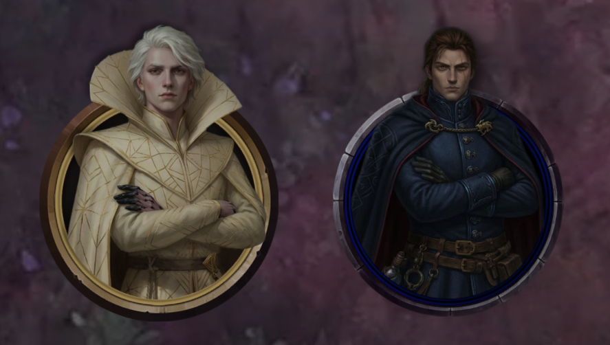
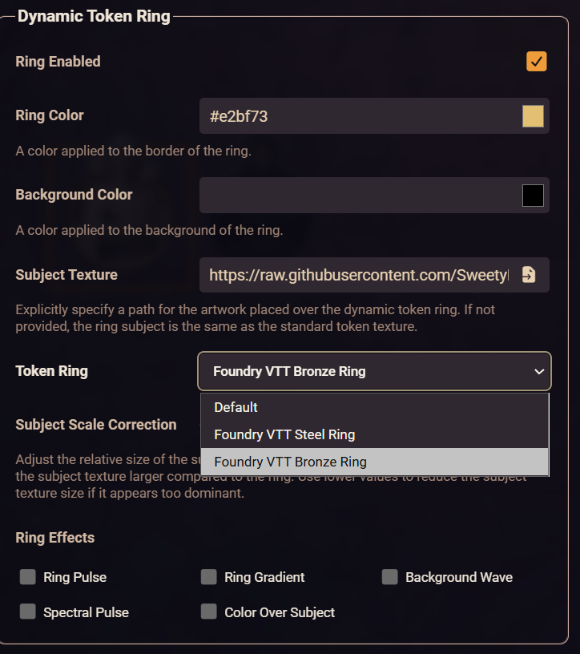

# Multiple Rings

**Different dynamic token rings for different tokens — for Foundry VTT v13+.**

Foundry allows only one dynamic ring style per world. This module removes that limit: every token can wear its own ring, chosen from all installed ring packs (core steel & bronze plus any added by other modules).

Recommended: [lib-wrapper](https://foundryvtt.com/packages/lib-wrapper) (without it the module patches the ring renderer directly).



---

## What you get

- A **ring selector** in the regular token settings (and prototype token settings).
- **Active Effects support** — give a boss a different ring in its second phase.
- **DAE-friendly** — the effect value is a dropdown of available rings, not a text field.
- **Smart memory use** — ring packs load only when actually used, unused packs are unloaded automatically, and render quality adapts to your device.
- **Safe by design** — if anything goes wrong (GPU limits, Foundry updates, missing modules), tokens simply fall back to the normal world-wide ring. Nothing crashes.

---

## Usage

### Token or actor

Open **Configure Token** (or **Configure Prototype Token** on an actor sheet) → *Appearance* tab → ring section → pick a pack from **Token Ring** → save.

Leave it on **Default** to follow the usual priority:

```
Active Effect → token → actor prototype → world setting
```

Leaving a placed token on **Default** means the token has no ring override of its own — it inherits
its actor prototype's ring (or the world setting if the prototype is also on **Default**), and saving
the token config will never copy the prototype's ring into the token. To use the world ring on a
single token whose prototype picks another pack, pick that ring pack explicitly on the token.



### Through an Active Effect

Add a change to any effect (on the actor, or on an item that transfers it):

| | |
|---|---|
| Key | `flags.multiple-rings.ringAppearance` |
| Mode | Override |
| Value | pick a ring from the dropdown |

In DAE's editor the key is searchable by name and the value is a select. Empty value = default ring.
With several ring effects active, the highest priority wins (later effects win ties) — the same
order Foundry applies changes in. Disabling, suppressing (e.g. unequipping the item) or deleting
the effect restores the previous ring. The token settings always show and save the token's own
choice, never the effect's.

---

## Settings

The module has no settings — to get vanilla behavior back, disable it in **Manage Modules**.
The quality budget is fully automatic.

### Quality budget

The atlas is one shared pixel budget, and it follows actual usage instead of preparing for every installed pack at once:

- Packs are planned and baked only when actually worn, plus the world default ring (whose medium variant always stays baked as the fallback).
- Within a worn pack, only the **size variants** its tokens actually resolve to are baked
  (each sheet ships Tiny→Gargantuan variants; a Medium party needs 2 of a pack's 10 frames,
  so a ~75 MB sheet costs ~2 MB of atlas).
- Oversized frames are **density-capped**: a frame is never baked denser than ~512px per grid
  cell of the largest token wearing it, because the ring shader can only ever sample it at the
  token's on-screen size. Standard packs (512px/cell) are unaffected; single-variant 2048px
  sheets like Sweety Rings bake at 25% for a Medium party — 16× less atlas memory at identical
  on-screen quality. If a larger token arrives, the pack re-bakes higher automatically.
- Every pack starts at the best quality the scene can actually use.
- The atlas widens to your GPU's maximum texture size (capped at 16384px, the largest canvas browsers allow) before anything is degraded — shrinking is the last resort, not the first. Tokens with the dynamic ring turned off cost nothing.
- Each plan keeps some spare rows, so a newly worn pack or token size usually just appends instead of re-baking everything. Frames are separated by a small transparent gutter so neighbours never bleed into a ring's edge.
- Overlay art (see below) lives in a second atlas that only exists while some worn pack has overlays.
- When a newly worn ring doesn't fit, all packs step down the ladder together — 100 → 90 → 80 → … → 10% — just enough to make room, staying within one rung of each other.
- When eviction removes packs that are no longer worn, quality steps back up automatically and the atlas shrinks. Shrinking a token works the same way: the size variants and density it no longer needs are released on the next sweep.
- Degradation order within a pass: least recently used packs first. The world default ring joins the normal order but never drops below 50%.
- Each step is logged to the console and counted in `MultipleRings.status()`.

---

## Two-layer tokens (ring overlays)

The classic token drawing order is `ring < subject` — the art always covers the ring, so a
bezel, clasps or any other "front" part of the frame can never overlap the character. This
module adds a third layer:

```
ring  <  subject  <  top layer
```

The top layer is part of the **ring pack sheet itself**: the sheet image carries the extra
art, and the sheet JSON declares it in a `config.overlays` block — one entry per size
variant, pointing at a frame rect of the same image:

```json
"config": {
  "overlays": {
    "dnd5e-med": { "frame": {"x": 0, "y": 1024, "w": 512, "h": 512} },
    "dnd5e-lrg": { "frame": {"x": 512, "y": 1024, "w": 512, "h": 512} }
  }
}
```

- **Works like a companion frame** (`-bkg`/`-msk`): authored once per variant, keyed by the
  base frame name, baked into the module's atlas together with the pack. A second "shadow"
  atlas stores the overlay art at the same coordinates as the ring frames, so the shader
  addresses it with the ring's own texture coordinates — the overlay inherits every ring
  scale correction and stays glued to the ring at any subject scale, fit mode or zoom.
- **Safe by design, both ways.** Neither PIXI nor the core ring renderer read
  `config.overlays`: with the module disabled a sheet with overlays renders a perfectly
  normal ring and the extra pixels are ignored. With the module enabled, tokens whose pack
  has no overlays render exactly as before — the overlay shader pass is skipped entirely.
- **Full PIXI integration, isolated from dynamic ring changes.** The overlay lives in the same
  token mesh and shader pass, drawn strictly above the ring, its effects (including
  `COLOR_OVER_SUBJECT`), and the subject (`ring < subject < top layer`). It undergoes all PIXI
  modifications applied to the token (`token.mesh.filters` shaders, mesh tint, alpha,
  hidden/occluded states, and the token config live preview), while remaining unaffected by
  dynamic ring color/effect changes (targeting, damage/healing flashes, ring pulse, gradient,
  or background wave).

Rendering uses the extension slot core provides for this exact purpose
(`DynamicRingData.framework.{ringClass,shaderClass}`) — no core patching. The overlay shader is
derived at runtime from core's own ring shader (three small injections), so core fixes carry
over automatically; if the core shader ever changes beyond recognition, the module detects it
and silently disables the overlay (rings keep working natively).

---

## Ring scale (pack-level)

A ring pack sheet can declare `config.scale` — how many times larger the **ring** is drawn
compared to the token wearing it:

```json
"config": { "scale": 2 }
```

- `scale: 2` renders the ring (with its background and top overlay) twice as large; the
  character art keeps its normal size. Range 0.1–10, `1` or omitting the field means no
  scaling.
- Implemented through core's own mechanics: the scale is injected as `configureSize`'s
  `scaleMultiplier` (`scaleCorrection = 1 / scale`), and core itself adds the mesh padding
  required by a magnified ring — the enlarged ring is never clipped, and the subject
  texture is untouched.
- Applied to every token rendering the pack — through its own choice, an effect, or because
  it is the world default ring — picked up on the next mesh refresh. While a chosen pack is
  still loading, the fallback ring is drawn at its own scale.
- **Multiple Rings only.** Core does not read `config.scale`; with the module disabled the
  field is inert and the sheet stays a normal ring sheet.

---

## Good to know

- **No FPS cost.** Rings render exactly like vanilla; everything happens when tokens are drawn, not every frame.
- **Seamless swaps.** Atlas rebuilds are atomic: a token keeps rendering its current ring while the new one bakes and switches straight to it — no flicker, no missing frames in between.
- **Memory and quality scale with usage.** Only packs actually worn by someone are loaded, and within them only the size variants their tokens use: unworn packs and unused variants cost nothing.
- **Packs unload immediately** once no placed token (or open token-config preview) wears them — checked on scene loads, scene switches, token deletions, closing token settings and ring/effect changes — and their source images are released too, so experimenting never bloats memory. `MultipleRings.evictNow()` forces a sweep.
- **World setting stays untouched.** Tokens without a choice keep using it. Changing it requires a reload (as in vanilla Foundry).
- **Custom ring renderers.** Packs that ship their own `framework.ringClass`/`shaderClass` are drawn with the core ring shader (their art, colors and frames are used, custom shader effects are not).
- **Failed packs heal.** A pack that failed to load or did not fit is retried automatically after a minute or on the next scene change.

---

## Troubleshooting

| Problem | Answer |
|---|---|
| Selector doesn't appear | Is the module enabled? Check console lines starting with `multiple-rings \|`. |
| Token shows the default ring instead of my pick | That pack didn't fit into your GPU atlas even at the bottom of the quality ladder — wear fewer packs at once. `MultipleRings.status()` shows the fill and per-pack scales. |
| Rings look soft when zoomed way in | That pack was degraded by the quality budget to fit the atlas, or density-capped because no worn token is large enough to show more detail. Let unused packs get evicted, or check `scale`/`cap` in `MultipleRings.status()`. |

---

## For macros and developers

```js
// Read or set a token's ring
token.document.getFlag("multiple-rings", "ringAppearance");     // e.g. "coreBronze" or ""
await token.document.update({ "flags.multiple-rings.ringAppearance": "coreBronze" });
```

Any Active Effect change with the same key works the same way.

### Console diagnostics

The module exposes a small API via `game.modules.get("multiple-rings").api`, aliased as `window.MultipleRings` for quick typing in the console:

```js
MultipleRings.status();             // per-pack scales and density caps, atlas fill, GPU limits, degraded count
MultipleRings.packs();              // just the per-pack array from status()
await MultipleRings.retryFailed();  // re-bake packs that didn't fit, without a reload
MultipleRings.evictNow();           // force-unload packs no placed token wears
await MultipleRings.replan();       // re-plan the budget and rebuild the atlas
```

`status()` is the quickest way to see the budget at work: **layout** compares the planned height against what everything would need at full quality, and each pack row shows its current `scale`, starting `startScale`, its density `cap`, and which size `variants` are baked (`variantsAll` is how many the sheet ships).
